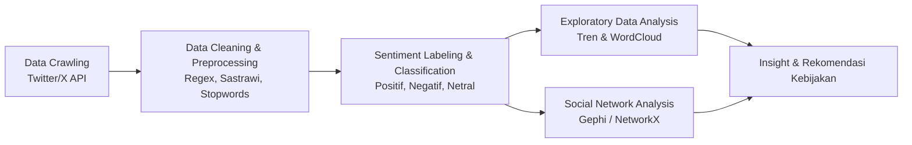

# 🍱 Public Sentiment Analysis on School Lunch Budget Policy
### Analisis Sentimen Publik & Social Network Analysis (SNA) Terhadap Kebijakan Anggaran Rp10.000 Makan Siang Bergizi Gratis (MBG) di Media Sosial X

[](https://www.python.org/)
[](Final_Project_Data_Mining_Group_B.ipynb)
[](data_sentimen.csv)
[]()

---

## 📌 Ringkasan Proyek (Project Overview)

Program **Makan Bergizi Gratis (MBG)** merupakan salah satu program strategis nasional yang ditujukan bagi lebih dari 83 juta penerima manfaat (anak sekolah, balita, dan ibu hamil) dengan tujuan utama menekan angka *stunting*, meningkatkan gizi anak, dan mendukung perkembangan kognitif generasi muda.

Pada perjalanannya, muncul diskursus publik yang hangat ketika estimasi alokasi anggaran yang semula direncanakan **Rp15.000 per porsi** disimulasikan menjadi **Rp10.000 per porsi**. Penyesuaian ini memicu berbagai tanggapan dari masyarakat, pakar gizi, praktisi kuliner, dan pengamat kebijakan fiskal.

Repositori ini menyajikan analisis komprehensif mengenai **sentimen publik dan dinamika percakapan di media sosial X (Twitter)** terkait perubahan anggaran tersebut dengan pendekatan:
1. **Natural Language Processing (NLP) & Text Mining** untuk ekstraksi sentimen dan identifikasi isu utama.
2. **Social Network Analysis (SNA)** untuk memetakan klaster aktor (Pro, Kontra, Media, dan Outlier/Buzzer).
3. **Analisis Pemengaruh (Key Influencers) & Tren Waktu** untuk melihat eskalasi opini publik.

---

## 🎯 Pertanyaan Penelitian (Research Questions)

1. **Bagaimana distribusi sentimen publik** terhadap penyesuaian anggaran Rp10.000 per porsi untuk program Makan Siang Bergizi?
2. **Apa saja narasi dan kekhawatiran utama** yang disuarakan oleh masyarakat di media sosial X?
3. **Bagaimana struktur peta jaringan percakapan (SNA)** antar-aktor dan siapa saja pemengaruh (*key opinion leaders*) paling dominan?

---

## 📊 Metodologi & Alur Kerja (Pipeline)



### 1. Pengumpulan Data (Crawling)
- **Sumber Data:** Media sosial X (Twitter).
- **Periode Pengambilan Data:** 15 November 2024 – 14 Desember 2024.
- **Kata Kunci Pencarian (Keywords):**
  `"makan siang gratis prabowo"`, `"janji makan siang gratis"`, `"makan siang gratis sekolah"`, `"makan bergizi gratis"`, `"makan siang gratis sepuluh ribu"`, `"makan siang 10.000"`, `"Rp10ribu makanan bergizi"`, `"anggaran makan bergizi"`, `"makan bergizi rp10.000"`, `"makan gratis harga rp10ribu"`.
- **Total Volume Data:** **3.065 cuitan mentah** ➡️ **2.252 cuitan unik** setelah pembersihan dan deduplikasi.

### 2. Pra-pemrosesan Teks (Text Preprocessing)
- **Cleaning:** Menghapus URL, mention username (`@username`), simbol, angka, dan emoji.
- **Case Folding & Normalization:** Menyeragamkan karakter ke huruf kecil.
- **Stopwords Removal:** Mengeliminasi kata umum bahasa Indonesia menggunakan pustaka `Sastrawi`.
- **Stemming:** Reduksi kata berimbuhan ke kata dasar.

---

## 📈 Temuan Utama (Key Findings)

### 1. Distribusi Sentimen Publik
Dari **2.252 mention** yang dianalisis:

| Kategori Sentimen | Persentase | Narasi Utama Percakapan |
| :--- | :---: | :--- |
| **Negatif** 🔴 | **50.3%** | Skeptis terhadap kecukupan gizi dengan pagu Rp10.000, kekhawatiran pemotongan margin vendor/catering, kekhawatiran beban APBN/utang luar negeri, serta dampak terhadap pengelola kantin sekolah. |
| **Netral** ⚪ | **28.7%** | Laporan pemberitaan media massa, perbincangan netral, serta kutipan pernyataan resmi tokoh politik/pejabat publik. |
| **Positif** 🟢 | **21.0%** | Apresiasi atas komitmen realisasi program, harapan pengurangan beban ekonomi orang tua murid, serta potensi perputaran ekonomi lokal (UMKM pangan). |

### 2. Tren Volume Percakapan
- Perbincangan mengalami kenaikan bertahap sejak akhir November 2024.
- **Puncak Percakapan (Spike):** Terjadi pada **13 Desember 2024** mencapai **478 cuitan per hari**, dipicu oleh rilis berita konfirmasi simulasi anggaran Rp10.000/porsi.

### 3. Pemetaan Jaringan Sosial (Social Network Analysis)
- **Pusat Mention (Hub):** Akun `@prabowo` menjadi pusat perhatian utama dengan lebih dari **303 mentions**.
- **Struktur Klaster:**
  - **Klaster Tengah (Kontra):** Mendominasi volume percakapan utama dengan interaktivitas tinggi.
  - **Klaster Media:** Menghubungkan berbagai klaster melalui penyebaran berita reguler.
  - **Klaster Outlier (Pro):** Terdapat kelompok akun pendukung yang membentuk sub-jaringan terisolasi di pinggir graf (*outlier*), dengan indikasi perilaku terkoordinasi/buzzer yang dominan berinteraksi hanya di internal kelompoknya.

### 4. Top Influencers (Berdasarkan Engagement)
- **Akun Kontra / Kritis:** `@realfedinuril` (38.544 engagement), `@kkmanti` (15.644 engagement), `@hermawan_devina` (13.905 engagement), `@andikamalreza`, `@jhonsitorus_18`.
- **Akun Media Berpengaruh:** `@kompascom` (2.824 engagement) mencatatkan tingkat efisiensi interaksi tertinggi per postingan.

### 5. Tagar Terpopuler
- `#PEKNAS` (23 mentions)
- `#Prabowo` (15 mentions)
- `#BadanGiziNasional` (15 mentions)
- `#MakanBergiziGratis` (12 mentions)
- `#MBG10000Cukup` (10 mentions)

---

## 💡 Rekomendasi Kebijakan (Policy Recommendations)

1. **Penyesuaian Anggaran Berbasis Regional (Disparitas Harga Pangan):**
   Standar Rp10.000 perlu dievaluasi dengan memperhitungkan indeks kemahalan harga pangan antar-wilayah (terutama kawasan 3T).
2. **Transparansi Distribusi & Rantai Pasok Digital:**
   Penyediaan dashboard digital terbuka untuk mengawasi alokasi dana dari kas negara hingga ke menu makanan siswa guna memitigasi potensi kebocoran anggaran.
3. **Pemberdayaan Kantin Sekolah & UMKM Lokal:**
   Melibatkan pengelola kantin lokal dan UMKM sebagai vendor penyedia agar program memperkuat ekosistem ekonomi sekolah, bukan mematikan mata pencaharian warga sekitar.

---

## 📁 Struktur Direktori Repositori

```text
├── Capstone Kel B.pdf                                # Slide presentasi laporan akhir proyek
├── Crawling_Group_02_~_CapStone_2_(UAS).ipynb        # Script notebook pengumpulan data Twitter
├── Final_Project_Data_Mining_Group_B.ipynb           # Notebook utama pemrosesan, visualisasi & analisis
├── data_sentimen.csv                                 # Dataset hasil pelabelan sentimen (2.252 baris)
├── tweets-data/                                      # Kumpulan raw CSV hasil pencarian kata kunci
│   ├── anggaran_makan_bergizi(NovDes2024).csv
│   ├── makan_bergizi_gratis(NovDes2024).csv
│   ├── makan_siang_10.000(NovDes2024).csv
│   └── ... (file dataset kata kunci lainnya)
└── README.md                                         # Dokumentasi proyek
```

---

## 🚀 Cara Menjalankan Proyek (Getting Started)

### Prasyarat
Pastikan Anda telah menginstal **Python 3.8+** dan modul-modul berikut:

```bash
pip install pandas numpy matplotlib seaborn plotly networkx squarify Sastrawi unidecode wordcloud nltk
```

### Menjalankan Notebook
1. Clone repositori ini:
   ```bash
   git clone https://github.com/afauzan14/Public-Sentiment-Analysis-on-School-Lunch-Budget-Policy.git
   cd Public-Sentiment-Analysis-on-School-Lunch-Budget-Policy
   ```
2. Buka Jupyter Notebook:
   ```bash
   jupyter notebook Final_Project_Data_Mining_Group_B.ipynb
   ```
3. Jalankan seluruh sel untuk mereproduksi analisis dan visualisasi.

---

## 👨‍💻 Kontributor & Tim Peneliti

Proyek ini disusun sebagai bagian dari *Final Project / Capstone Data Mining (Kelompok B)*:

| Nama | Peran & Kontribusi |
| :--- | :--- |
| **Ahmad Fauzan** | **Penulis Script Code & Ekstraksi Insight Data** |
| Dani Hidayat | Penulis Script Code & Ekstraksi Insight Data |
| Baharuddin Syaefullah A. | Presentator & Analisis Insight |
| Nadira Afsarina Biya | Presentator & Analisis Insight |
| Kiara Zerlin Windriyani | Presentator & Analisis Insight |

---

*Dikembangkan untuk tujuan akademik, riset data mining, dan keterbukaan analisis opini publik.*

