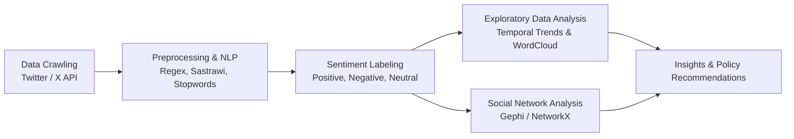

# 🍱 Public Sentiment Analysis on School Lunch Budget Policy
### Public Sentiment & Social Network Analysis (SNA) on the Rp10,000 Free Nutritious Meal (MBG) Budget Allocation on X (Twitter)

---

## 📌 Project Overview & Business Understanding

The **Free Nutritious Meal (*Makan Bergizi Gratis* / MBG)** program is an Indonesian national strategic initiative targeting over 83 million beneficiaries—including schoolchildren, toddlers, and expectant mothers—with the primary goal of alleviating childhood stunting, improving nutritional intake, and supporting cognitive development.

During its preparatory phase, intense public debate emerged when the estimated budget allocation, originally proposed at **Rp15,000 per meal portion**, was simulated down to **Rp10,000 per portion**. This fiscal adjustment prompted widespread discourse across civil society, pediatric nutritionists, culinary professionals, and economic observers.

This repository delivers a comprehensive data-driven investigation into **public sentiment and conversational dynamics on X (Twitter)** regarding the budget revision, using:
1. **Natural Language Processing (NLP) & Text Mining** for sentiment classification and thematic topic discovery.
2. **Social Network Analysis (SNA)** to map cluster structures (Critical/Opposing, Supportive, Media Broadcast, and Coordinated Networks).
3. **Key Opinion Leader (KOL) & Temporal Escalation Analysis** to trace public opinion formation and virality spikes.

---

## 🎯 Research Questions

1. **What is the overall sentiment distribution** regarding the proposed Rp10,000 per meal budget policy among social media users?
2. **What are the dominant public concerns, narratives, and critiques** emerging from conversations on X?
3. **What does the communication network topology (SNA) reveal** about polarization, echo chambers, and key opinion leaders?

---

## 🔬 Methodology & Analytical Pipeline

### 1. Data Collection (Crawling)
* **Platform:** Social Media platform X (formerly Twitter).
* **Observation Period:** November 15, 2024 – December 14, 2024.
* **Search Keywords:**
  `"makan siang gratis prabowo"`, `"janji makan siang gratis"`, `"makan siang gratis sekolah"`, `"makan bergizi gratis"`, `"makan siang gratis sepuluh ribu"`, `"makan siang 10.000"`, `"Rp10ribu makanan bergizi"`, `"anggaran makan bergizi"`, `"makan bergizi rp10.000"`, `"makan gratis harga rp10ribu"`.
* **Total Corpus Volume:** **3,065 raw posts** ➡️ **2,252 unique posts** post-cleaning and deduplication.

### 2. Text Preprocessing & Hygiene
* **Data Cleansing:** Stripped hyperlinks, user mentions (`@username`), special characters, numbers, and emojis.
* **Case Folding & Normalization:** Standardized text into uniform lowercase.
* **Stopword Removal:** Filtered common non-contextual Indonesian terms using the `Sastrawi` NLP package.
* **Stemming:** Reduced morphological inflections to foundational root words.

---

## 📈 Key Findings

### 1. Public Sentiment Distribution
Across the **2,252 unique posts** analyzed:

| Sentiment Category | Proportion | Core Discussion Narratives |
| :--- | :---: | :--- |
| **Negative** 🔴 | **50.3%** | Skepticism regarding dietary nutritional adequacy at the Rp10,000 threshold, concerns over vendor margin reductions affecting food quality, national budget (APBN) strain, and disruption to local school canteens. |
| **Neutral** ⚪ | **28.7%** | Mainstream news reporting, factual discourse, policy updates, and verbatim statements from government officials. |
| **Positive** 🟢 | **21.0%** | Commendation for program execution, anticipation of reduced household food expenditure for families, and potential economic stimulation for local agri-food micro-enterprises. |

---

### 2. Temporal Conversation Trends
* Discussion volume experienced steady growth starting in late November 2024.
* **Virality Peak:** Occurred on **December 13, 2024**, reaching **478 posts within a single day**, triggered by official press statements confirming the Rp10,000 budget trial.

---

### 3. Social Network Analysis (SNA) & Cluster Topology
* **Central Interaction Hub:** The official account `@prabowo` formed the primary nexus of the network with over **303 inbound mentions**.
* **Cluster Dynamics:**
  * **Critical Cluster (Central Hub):** Dominated network volume with high organic engagement, retweets, and interactive debates.
  * **Media Bridge Cluster:** Functioned as neutral information conduits disseminating real-time news updates across disconnected sub-networks.
  * **Peripheral Outlier Cluster:** Composed of supportive accounts displaying localized, repetitive engagement patterns with low external reach—exhibiting hallmarks of coordinated amplification.

---

### 4. Key Opinion Leaders (Ranked by Engagement)
* **Critical & Influential Voices:** `@realfedinuril` (38,544 total engagement), `@kkmanti` (15,644 engagement), `@hermawan_devina` (13,905 engagement), `@andikamalreza`, and `@jhonsitorus_18`.
* **High-Efficiency Media Channels:** `@kompascom` (2,824 engagement) recorded the highest engagement rate per broadcast post.

---

### 5. Dominant Hashtags
* `#PEKNAS` (23 mentions)
* `#Prabowo` (15 mentions)
* `#BadanGiziNasional` (15 mentions)
* `#MakanBergiziGratis` (12 mentions)
* `#MBG10000Cukup` (10 mentions)

---

## 💡 Strategic Policy Recommendations

### 1. Regionally Adjusted Pricing Indices
A flat Rp10,000 nationwide budget neglects stark geographic disparities in food production costs. The allocation should adopt an index-based model that adjusts per-meal budgets according to regional food consumer price indices—especially in frontier, outermost, and disadvantaged (3T) regions.

### 2. Supply Chain Transparency & Digital Dashboards
Deploy a publicly accessible digital tracking dashboard monitoring budget disbursement from the state treasury to local kitchens and final meal distribution, mitigating leakages and preserving nutritional standards.

### 3. Inclusive School Canteen Integration
Rather than relying exclusively on large industrial catering vendors, the program should integrate existing school canteens and neighborhood food cooperatives as verified suppliers, preserving local livelihoods and ensuring culturally accepted meal menus.
